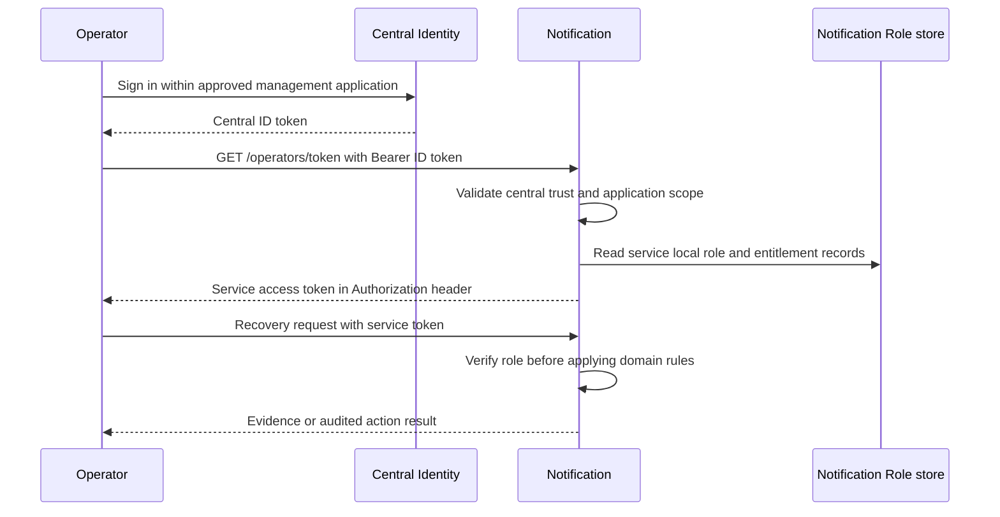

# Operator investigation and recovery

The owner approved this design on 25 November 2026 (Pacific/Auckland) and deferred
implementation. Operators obtain access through the existing manual data access
process. The provider receipt rollout uses its own Resend signing configuration.
The work below applies when the owner resumes the operator feature.

## Identity and authority

Use the released Niobium identity pipeline and repositories. Central Identity
issues an RSA signed ID token. Notification validates its issuer, audience,
signature, lifetime, one actor `Sid` and one `GroupSid` matching the configured
management application. The current central issuer uses the login app ID for
`aud` and `GroupSid`. Confirm the actual issuer configuration during rollout.
[Central Identity issuance](https://github.com/niobium-nz/Niobium.Identity/blob/e8ac5361414f88f4369043ed48b1eef3ddd28c19/src/Niobium.Identity.API.Core/AuthenticationDomain.cs)

Expose the exchange as **GET only** at `/operators/token`, following the owner's
confirmed Niobium contract. The shared client uses its configured Notification
`AccessTokenHost` and `AccessTokenEndpoint`, and calls
`IdentityService.RefreshAccessTokenAsync`. Accept the central token through one
`Authorization: Bearer …` request header. Return HTTP 200 with an empty body,
the service token in the Authorization response header and
`Cache-Control: no-store`. Reject other methods before role lookup and keep the
identity pipeline scoped to the exchange route.
[Shared IdentityService](https://github.com/niobium-nz/Niobium/blob/e82065df679af28d78b02ce1b25d78b970c57172/Niobium.Channel.Identity/IdentityService.cs)

After validating the ID token, the framework reads Notification's own `Role`
and `Entitlement` tables. The service issues an environment scoped HS256 JWT
with its ordinary default role and roles assigned locally. Privileged authority
comes from the exact `NOTIFICATION_RECOVERY_OPERATOR` role in that local
store. The `Entitlement` table can be empty. Backend access stays with the
application and the existing manual administration process.
[Niobium token exchange](https://github.com/niobium-nz/Niobium/blob/e82065df679af28d78b02ce1b25d78b970c57172/Niobium.Platform.Identity/AccessTokenMiddleware.cs)

Require the service token and exact operator role on each recovery route before
looking up the target submission. Verify the service issuer, audience, signature,
lifetime and single actor and management group. Derive audit actor, management
group and issuer from the verified service token and use the server clock.
The role covers all Notification tenants in the selected environment and authorizes
inspection, assessment and deliberate copies. The management application identifies
the operator's login scope. The notification tenant in the route identifies the
target of the operation.

Issue service tokens for 15 minutes. Removing a role takes effect on the next
exchange. An issued token can retain the old role through its expiry and the
framework's five minute clock skew. The initial design uses explicitly configured
central trust and a single service operator role. An operator UI, separate read only
role, second approval and immediate token revocation are outside this increment.

## Recovery behavior and data model

The base route is `/operators/tenants/{notificationTenant}/submissions/{submissionID}`.

| Request | Behavior |
| --- | --- |
| GET base route | Return transport facts, state, revision and latest committed action |
| GET `/history` | Read committed actions with a stable operation cursor, at most 20 per page |
| POST `/assessments` | Record an assessment for a Held submission at the reviewed revision |
| GET `/assessments/{operationID}` | Read the committed assessment by its stable UUID |
| POST `/copies` | Request one separate saved content copy at the reviewed revision |
| GET `/copies/{operationID}` | Read the committed copy authorization and dispatch state |

Each command carries a stable operation UUID, expected revision, reason and
evidence reference. Use a separate UUID for each intended action. Assessment
dispositions are `ProviderSubmissionConfirmed`, `NoProviderSubmissionConfirmed`
and `Unresolved`. The first requires a provider message ID. Keep assessments as
attestations alongside the original transport facts, suppression state, attempt
count and provider window. Only a verified provider Delivered receipt establishes
recipient mail server acceptance.

Allow a deliberate copy from a Held, Accepted or Failed source with frozen
content. Keep Pending and Sending sources ineligible. Missing content requires
manual investigation. Preserve the original submission and its transport facts.
Create the child with the saved sender, provider account and content plus a new
operation identity and receipt proof. Use that child's stable provider identity
and frozen content for its own automatic retries.

1. Reserve the audit action, child and frozen content. Use the reviewed revision
   in a conditional source write and verify the persisted result.
2. Commit authority only after the source anchors the intended action and the
   child and content have been verified. Queue dispatch after commit. A pending
   child or blob carries no dispatch authority.
3. Dispatch through the separate typed queue. Recheck the committed action,
   existing child, saved account and frozen content before each attempt. Schedule
   recovery before the provider call and use the existing bounded retry window.
4. Return HTTP 202 for accepted dispatch. Keep the same UUID and body after an
   uncertain response and inspect or replay that operation. Changes to an
   existing request conflict and a stale revision requires another inspection.
   A copy has its own receipts. Link lineage to the source while keeping the
   delivery facts of the two operations independent.

Use `NotificationRecoveryAction` to store private versioned assessment and copy
records with explicit mapping to public response contracts. Keep source revision,
actorship, evidence and content bindings in the audit. Models own key derivation,
hashes and content paths. Use business names with EntityKey attributes. Domains
own eligibility, state transitions, conditional writes and readback. Flows
coordinate queue and provider work. Keep reads free of repair writes.

Use version 4 for recovery rows to fence older writers from replacing audit data.
Test stale ETags, competing operations, ambiguous writes, queue acknowledgements
and interrupted dispatch. A commit marker and verified source link establish
authority through retries. Preserve committed history across rollback and keep a
missing committed child on hold for investigation. Stored digests detect consistency
errors. The audit design assumes trusted storage administration.

[Configure and validate the deferred operator feature](operator-recovery-setup.md)
 · [Model and repository boundaries](model-contracts.md)
 · [Invoicing Q29](https://github.com/niobium-nz/Niobium.Invoicing/blob/main/docs/decisions-and-risks.md#q29-delivery-follow-through-and-accepted-business-recommendations)
